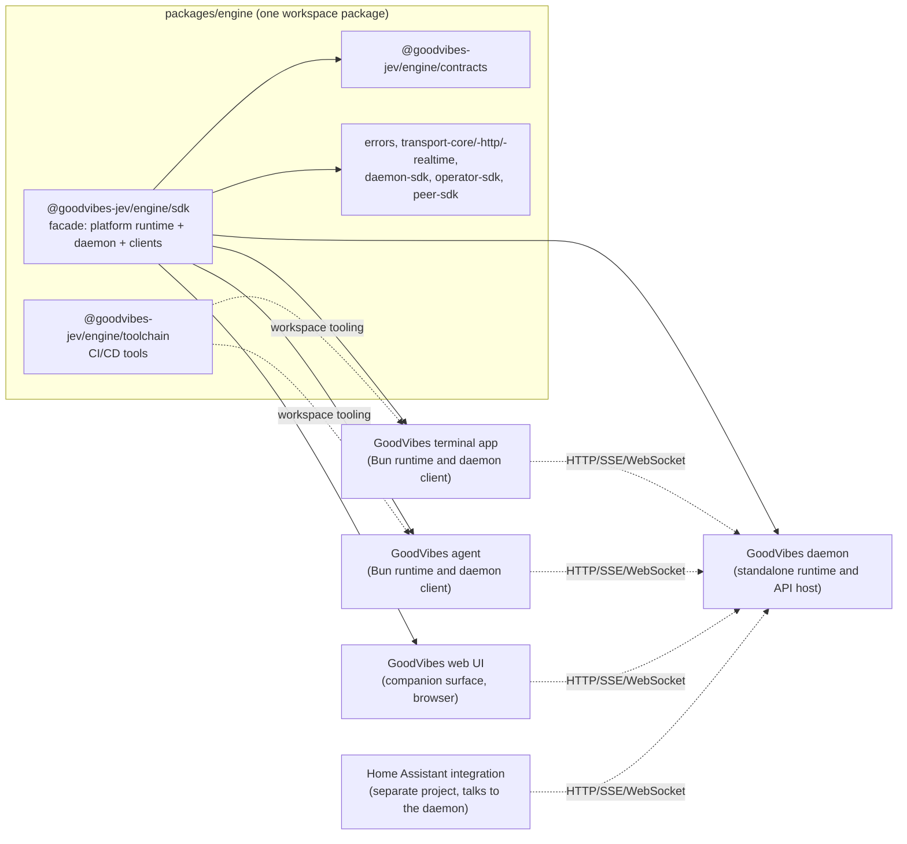

# GoodVibes engine

[](https://github.com/mgd34msu/goodvibes-jev/actions/workflows/ci.yml)
[](https://opensource.org/licenses/MIT)

The engine is the typed TypeScript platform layer behind the GoodVibes Jev products: sessions, provider/model routing, in-process agents, a knowledge and memory store, a control-plane HTTP and realtime API, and the transports that carry it all. The daemon is its own product, built on the engine. Full-surface consumers embed runtime behavior in a Bun process and connect to daemon services as clients. Companion consumers, including the WebUI and mobile clients, use HTTP, SSE and WebSocket. The workspace package `@goodvibes-jev/engine` carries the platform through explicit subpaths such as `@goodvibes-jev/engine/sdk`, `@goodvibes-jev/engine/contracts` and `@goodvibes-jev/engine/errors`.

Use the [monorepo installation guide](../../docs/installation.md) to install the
application suite. Engine integration and product acceptance remain in progress;
older SDK release history does not certify this checkout. Current behavior for
[completion verification](docs/runtime-orchestration.md#completion-verification),
[project review inventory](docs/contract-criteria.md#project-review-inventory) and
[owner-configured tool access](docs/tool-safety.md#owner-configured-access) lives
in the engine.

Public contract, config keys, route paths, event shapes, and file layouts follow the semver policy in `docs/semver-policy.md`. Pin exact versions and read `CHANGELOG.md` before upgrading.

**Hosted-turn cancellation is scoped to owned execution.**
Its settlement boundary covers the turn's owned provider, tool, hook, and hook-Agent
work. Independent workflow-trigger automations may continue; `TURN_CANCEL` is not a
global “all side effects stopped” receipt. Uncooperative owned work must stay pending
rather than be reported drained. See the [cancellation contract and platform limits](docs/hosted-turn-cancellation.md)
and the [retained review evidence](docs/decisions/2026-10-16-hosted-turn-review-boundary.md).



---

## Install

Prepare the engine through the monorepo workspace:

```bash
# From the goodvibes-jev repository root:
bun install
bun run build
```

Products depend on `@goodvibes-jev/engine` through `workspace:*`; import only
declared entry points. For a Bun host (terminal app, agent, CLI, daemon), the SDK
client factory talks to a reachable GoodVibes daemon:

```ts
import { createGoodVibesSdk } from '@goodvibes-jev/engine/sdk';
import { createMemoryTokenStore } from '@goodvibes-jev/engine/sdk/auth';

const sdk = createGoodVibesSdk({
  baseUrl: process.env.GOODVIBES_BASE_URL ?? 'http://127.0.0.1:3421',
  tokenStore: createMemoryTokenStore(process.env.GOODVIBES_TOKEN ?? null),
});

const snapshot = await sdk.operator.control.snapshot();
```

Building a browser or web UI client instead, the companion entry point carries no Bun globals and bundles cleanly with Vite, webpack, and esbuild:

```ts
import { createBrowserGoodVibesSdk } from '@goodvibes-jev/engine/sdk/browser';
import { createBrowserTokenStore } from '@goodvibes-jev/engine/sdk/auth';

const sdk = createBrowserGoodVibesSdk({
  baseUrl: 'https://goodvibes.example.com',
  tokenStore: createBrowserTokenStore(),
});

const stop = sdk.realtime.viaSse().agents.on('AGENT_COMPLETED', (event) => {
  console.log('agent completed', event);
});
```

React Native, Expo, and Cloudflare Worker bridges follow the same pattern from their own subpaths. The canonical walkthrough for every runtime is [docs/getting-started.md](./docs/getting-started.md), and runnable versions of each are in [examples/](./examples/README.md).

---

## Entry point map

| Entry point | What it is |
| --- | --- |
| [`@goodvibes-jev/engine/sdk`](./sdk) | The full platform runtime (sessions, agents, providers, knowledge, control plane, daemon route handlers) plus thin client factories for Bun, browser, React Native, Expo, and Cloudflare Workers. |
| [`@goodvibes-jev/engine/toolchain`](./toolchain) | The CI/CD toolchain: release cut, npm publish, per-job-green verification, and coverage checks. Invoked as `bunx @goodvibes-jev/engine/toolchain <tool>` from every GoodVibes repo's release workflow. |
| [`@goodvibes-jev/engine/contracts`](./contracts) | Runtime-neutral operator and peer contract artifacts, generated method IDs, and lookup helpers that the `sdk` entry points and every client surface share. |

The same install also carries `errors`, `transport-core`, `transport-http`, `transport-realtime`, `daemon-sdk`, `operator-sdk`, `peer-sdk`, and `terminal-shell`, each imported as `@goodvibes-jev/engine/<name>`; none is a separate install step. The full entry-point matrix is [docs/packages.md](./docs/packages.md).

### Entry points at a glance

| Entry point | Use it for |
| --- | --- |
| `@goodvibes-jev/engine/sdk` | Full Bun SDK: client factory plus contracts, daemon, auth, operator, peer, and transports |
| `@goodvibes-jev/engine/sdk/daemon` | Daemon route dispatch and embedding helpers for a Bun server host |
| `@goodvibes-jev/engine/sdk/browser`, `/web` | Full browser and web UI client factories with the complete operator contract |
| `@goodvibes-jev/engine/sdk/react-native`, `/expo` | React Native and Expo client factories with mobile secure token stores |
| `@goodvibes-jev/engine/sdk/workers` | Cloudflare Worker bridge for daemon batch endpoints |
| `@goodvibes-jev/engine/sdk/contracts` | Runtime-neutral contract types, schemas, and method IDs |
| `@goodvibes-jev/engine/sdk/auth` | Token stores, login, and OAuth helpers, shared by every surface |

This is a starting point, not the full list. There is no root `@goodvibes-jev/engine/sdk/platform` entry and no `platform/*` wildcard export. The canonical, stability-leveled reference for every entry point is [docs/public-surface.md](./docs/public-surface.md).

---

## Key concepts

- **Two runtime surfaces.** Full (Bun: TUI, agent, daemon hosts) vs. companion (browser, React Native, Expo, Workers). See [docs/getting-started.md](./docs/getting-started.md) and [docs/surfaces.md](./docs/surfaces.md).
- **Public entry points.** The single canonical, stability-leveled list of every importable subpath: [docs/public-surface.md](./docs/public-surface.md).
- **Contracts.** The typed vocabulary (method IDs, endpoint IDs, event maps) every client and the daemon share: [docs/packages.md](./docs/packages.md).
- **Authentication.** Login, bearer tokens, and platform-specific secure token stores: [docs/authentication.md](./docs/authentication.md).
- **Realtime transports.** SSE and WebSocket with reconnect and typed, session-filtered event domains: [docs/realtime-and-telemetry.md](./docs/realtime-and-telemetry.md).
- **Knowledge and memory.** The SQLite-backed knowledge/wiki system, ingestion, retrieval, and project planning artifacts: [docs/knowledge.md](./docs/knowledge.md).
- **Provider and model runtime.** Daemon-side routing, failover, and catalogs across model providers: [docs/providers.md](./docs/providers.md).
- **Errors.** A typed `SDKErrorKind` model. Match on `err.kind`, never on `err.message`: [docs/error-kinds.md](./docs/error-kinds.md).

Full index: [docs/README.md](./docs/README.md).

---

## Development

```bash
git clone https://github.com/mgd34msu/goodvibes-jev.git
cd goodvibes-jev
bun install
bun run build
```

| Command | Does |
| --- | --- |
| `bun run build` | Build judgment, engine and all four products from the monorepo root |
| `bun run test` | Run installer, judgment, engine and product tests through their owned runners |
| `bun run validate` | Run the local integration gate: build/types, API/contracts, exports, packaging and runtime checks; see the full gate reference below |
| `bun run api:extract` / `bun run api:check` | Regenerate / verify the API Extractor reports under `etc/*.api.md` |
| `bun run refresh:contracts` | Regenerate shared contract artifacts and product snapshots after a contract change |
| `bun run docs:generate` / `bun run docs:check` | Regenerate / verify API reference docs; the check also verifies required docs and examples exist |

CI (`.github/workflows/ci.yml`) runs `validate`, a standing eval gate scored against a checked-in baseline, a dependency and secret-scan audit, a single `build` that every downstream job restores rather than rebuilding, a `platform-matrix` job (Bun tests plus companion-bundle and Workers runtime legs), a types-resolution check over the packed exports map, `publint`, and a packaged-artifact conformance lane. On a green `main` push, an auto-release job tags and dispatches the release, but only while the repo's `RELEASE_ARMED` variable is set. Full gate reference: [docs/testing-and-validation.md](./docs/testing-and-validation.md).

---

## Release and stability

The monorepo owns versioning and release workflows. The root version governs
the engine, judgment and daemon; the other product manifests retain their own
versions. The application products are private workspaces and the suite is
installed from this checkout. Export and compatibility rules are recorded in
[the semver policy](./docs/semver-policy.md); release machinery and its explicit
gates are described in [release and publishing](./docs/release-and-publishing.md).
Update an installed suite with the [repository installer](../../docs/installation.md#update-and-check-the-installation).

## Security

Report vulnerabilities through the repository [security policy](../../SECURITY.md).
Engine security boundaries and dependency posture are described in
[docs/security.md](./docs/security.md). Updating the installed suite rebuilds
the selected repository commit and its locked dependencies.

## License

MIT. See [LICENSE](./LICENSE).
